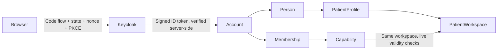

# Comfort: identity and records backend

This prototype uses self-hosted Keycloak OAuth 2.0 / OpenID Connect, Django and PostgreSQL. Sign-in creates a new empty patient workspace for a previously unseen validated identity. Existing identities keep their workspace and current access restrictions. The workspace now provides upload, keyword/AI search, metadata review, image preview/download, private consultation packets, source-linked overview drafts and reviewed term explanations. See the [assistant contract](records/ASSISTANT.md).

On 13 October all 127 identity/records/assistant tests passed on native PostgreSQL. Successful model responses in those automated tests are mocked to test validation and authorization. Separately, the pinned local Apertus 8B text conversion is installed and connected; real generation evidence is retained in ignored runtime artifacts. JPEG/PNG previews and bounded Part 10 DICOM header inspection keep technical facts separate from confirmed metadata. DICOM rendering, bulk studies, OCR and multimodal inference remain pending.

## Run the local synthetic demo

Prerequisites: Docker Engine/Desktop with Linux containers, Docker Compose v2 supporting `--wait`, GNU Make, free localhost ports 8000/8081 and at least 4 GB allocated container memory. Initial image/package downloads need network access. For AI features, also configure a reachable Apertus endpoint or start the optional [local Windows model server](intelligence/README.md). The app Docker launch does not install/start that host server or establish air-gapped readiness.

From the repository root (the directory containing `track_2b/`):

```sh
make run
```

Open **http://localhost:8000** (use this hostname consistently). `make run` generates private `track_2b/.env` secrets and `track_2b/.runtime/continuity-realm.json`, imports two synthetic Keycloak users, runs migrations in a separate owner service and starts the web service with a restricted database role. Read `track_2b/.runtime/demo-credentials.txt` locally for the `patient.alice` and `patient.bob` passwords. The application never receives their passwords; the browser signs in through Keycloak. The root Makefile selects the existing track Compose directory explicitly; only the Makefile moved, following the organizer's clarification shared on 13 October.

Open the homepage again after updating the app, so that forms use the current security headers. `Referrer-Policy: same-origin` preserves the origin needed by CSRF on local form submissions and sends no referrer to other origins. CSP form-action permits only the app and the configured public Keycloak origin, including redirects after form submission. Null/untrusted origins and missing CSRF tokens remain rejected. On Windows, Docker Desktop runs as your Windows user, so that user must be able to read the private realm file. Files created by a separate sandbox account may need a narrowly scoped Windows ACL grant to the project owner; retain their contents rather than regenerating secrets.

The two synthetic users have reserved example.invalid email addresses to satisfy Keycloak's default profile requirements; these addresses are unverified and are not used to link patient identities. Existing realms are not overwritten during startup. An older demo user with a missing email may see an Update Account Information screen; use only the corresponding reserved demo address, never real personal information.

Do not copy the blank `.env.example` before first startup. The initializer refuses incomplete or mismatched existing configuration instead of replacing secrets. Repeat runs preserve the generated files and database. `make stop` stops containers and preserves the database volume. Recovery requires retaining the matching `.env`, realm and database; changing a client secret in `.env` alone will break sign-in because an existing Keycloak realm is not reimported automatically. Fresh-demo recreation is a deliberate data-reset operation, not part of `make run`.

Without Make, use these equivalent commands from the repository root in PowerShell or a terminal:

```sh
docker compose --project-directory track_2b --file track_2b/compose.yaml run --rm --no-deps bootstrap
docker compose --project-directory track_2b --file track_2b/compose.yaml up --build --detach --wait app worker
```

The generated realm is for Keycloak UID 1000; the Docker initializer assigns its private import file accordingly and retains host-user ownership of the other local configuration files. On Windows these files also inherit the workspace ACLs. Keep the workspace private.

## Identity and authorization



- Identity key is the verified `(issuer, subject)` pair. Email, provider role claims and request-supplied patient IDs never link accounts to existing patients or grant access.
- A person can be a patient without an account. The canonical workspace points to its patient subject and has no `owner_user_id`.
- Atomic onboarding creates a fresh self-declared person, account, patient, workspace, self membership, explicit read capability and audit event. This establishes control of an empty profile, not verified civil or clinical identity.
- The installed capability catalogue contains only `membership / workspace` for read_workspace_records, upload_source, review_metadata and prepare_packet. Each action needs its own live capability; source-consuming write workflows additionally require read access. Every other action/authority combination fails closed. Guardian, caregiver, assistant and clinician workflows are future slices.
- Requests recheck account/person/patient/workspace status, established self relationship, matching person IDs, same-workspace capability, validity intervals and revocation. Membership alone and staff/superuser flags provide no patient-data authority. Revoked access is never repaired on login.
- Authlib verifies state, PKCE, RS256 signature against Keycloak keys, issuer, audience, nonce and expiry. Sign-in attempts expire after ten minutes and are single-use. Sessions expire no later than the ID token, capped at 15 minutes (demo tokens last five minutes). Tokens are not retained in the session or audit trail.
- Sign-out is a CSRF-protected POST; it invalidates the local session before redirecting to Keycloak logout. Provider logout may ask for confirmation because no ID-token hint is retained.
- Existing Keycloak-side account disabling is bounded by the remaining session/token lifetime; immediate back-channel logout is not implemented. Local account disabling or workspace authority revocation takes effect on the next request.

## Database contract

`identity/models.py` and `identity/migrations/` are the executable contract for this slice. Ordinary checks and unique keys are in `0001_initial.py`. `0002_postgresql_guards.py` adds Gregorian date validation, self-person equality, immutable identity/subject/membership bindings, a composite workspace/membership FK, capability validity bounds at issuance and append-only audit/catalogue guards. Parent validity may subsequently shorten; request-time authorization takes the intersection.

The migration service owns schema changes. The application uses `continuity_app`, which cannot change the schema/catalogue, overwrite audit entries or delete identity/history rows. Keycloak uses its own database and role. Authentication is separate from workspace authorization; there is no general health-data access based on login alone. No database row-level security is claimed in this slice.

## Verify

After `make run`:

```sh
make test
```

Tests use a separate PostgreSQL test database through the migration service. A signed local OIDC fixture exercises the actual Authlib token exchange, PKCE/JWKS validation and negative claims; it is a protocol fixture and does not replace Keycloak integration testing. Coverage includes anonymous/unrelated users, disabled accounts/subjects, missing capabilities, expiry/revocation, false self memberships, cross-workspace grants, partial dates, immutable bindings, database privileges, callback replay and CSRF.

Local Python checks can use an explicitly selected SQLite configuration:

```sh
DEMO_MODE=1 USE_SQLITE=1 DJANGO_SECRET_KEY=local-test-only python manage.py test identity --settings=continuity.test_settings
```

Run that command from `src/` after installing `../requirements.txt`. Set equivalent environment variables separately in PowerShell. PostgreSQL guard/role tests are skipped with SQLite; SQLite results do not verify the deployment database. Never run tests against clinical data.

Earlier verification on 2 October 2026: all 40 identity tests passed on native PostgreSQL. Real Keycloak browser sign-in reached Alice's and Bob's separate empty workspaces; each was denied the other's workspace. Sign-out and persistence after container restart were checked. Browser checks used the available Chromium preview; Chrome was not attached to automation. Earlier PGlite checks passed 38 tests; native tests supersede those for PostgreSQL behavior.

On 10 October all 68 identity/records tests passed on native PostgreSQL, covering authorized upload/download, duplicate/replacement versions, immutable originals/assertions/packets, source integrity, typed/partial dates, metadata revision conflicts, exact packet selection, worker/provider failures, CSRF and continuing read authority. A restricted-role worker regression avoids locking immutable source rows. Tests use mocked model replies only for protocol behavior. The running HTTP API passed upload/duplicate/download/review/packet and unrelated-patient checks with isolated synthetic session fixtures and the actual background worker while the provider is unavailable; it does not repeat the earlier real Keycloak browser proof. Restarting all four servers retained original checksum, extraction, packet snapshot and waiting job, and all services returned healthy. Migration drift/Compose checks passed. Full clean-checkout make run and live Apertus evaluation remain pending.

## Deployment and submission status

The Compose configuration binds the app and Keycloak to loopback and intentionally runs a synthetic HTTP demo. It is not a production deployment. Organization deployment requires a production Keycloak configuration, HTTPS, trusted proxy configuration, real account verification/recovery and operational controls. Runtime and migration credentials stay separate; do not give the web role schema-owner credentials.

CSCS approval remains pending. The optional local CPU Apertus text server now provides real inference for the records and assistant workers. Missing configuration still produces waiting_model; configured-but-unreachable or invalid-output generations fail explicitly. Patient-confirmed metadata and frozen packets are never overwritten by AI. Clinician grants/contributions, broader care workflows, full quality evaluation, containerized model reproduction, report PDF and video remain pending. The [five-case synthetic text trial](intelligence/README.md) is separate from clinical validation and the final evaluation.

References: [Authlib Django/OIDC integration](https://docs.authlib.org/en/stable/oauth2/client/web/django.html), [Keycloak container/import setup](https://www.keycloak.org/server/containers), [Keycloak frontend/backchannel hostname](https://www.keycloak.org/server/hostname), [PostgreSQL constraints](https://www.postgresql.org/docs/current/ddl-constraints.html), [PGlite socket limitations](https://pglite.dev/docs/pglite-socket). Dependency licenses remain with their distributions; project code uses the root Apache-2.0 license.
